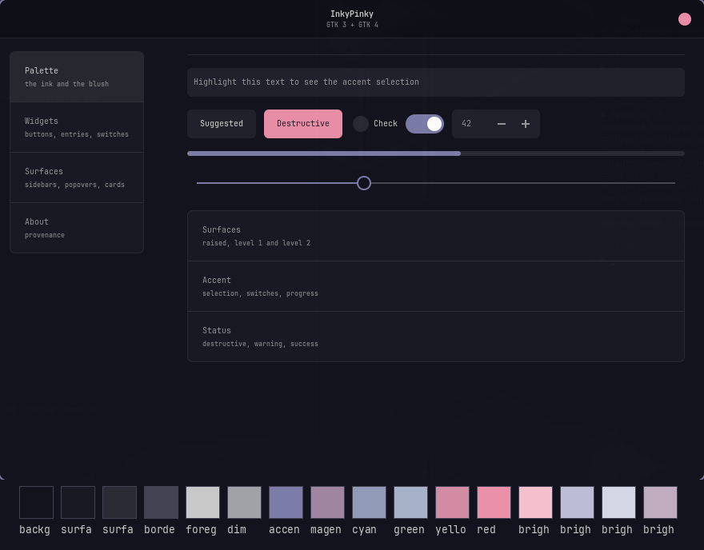

# InkyPinky GTK

**A GTK 3.0 and GTK 4.0 theme for the [InkyPinky](https://github.com/HANCORE-linux/omarchy-inkypinky-theme) Omarchy theme.**

InkyPinky is where bold meets blush. This is the GTK half of that — a full
GTK 3 and GTK 4 stylesheet set (plus a gnome-shell theme, since it came along
for the ride) carrying the same ink-and-blush palette as the Omarchy theme:
ink backgrounds, a muted lavender accent, and a soft pink for anything that
needs to shout.

It is a **GTK theme**, not an Omarchy theme. It contains no `colors.toml`, no
`hyprland.conf`, no `backgrounds/` — none of the things `omarchy-theme-install`
needs. Install the Omarchy theme first, then layer this on top for your GTK
apps.



## Install

**1. Install the InkyPinky Omarchy theme — this theme follows it, not the other
way around:**

```bash
omarchy-theme-install https://github.com/HANCORE-linux/omarchy-inkypinky-theme.git
```

**2. Clone this theme into `~/.themes`:**

```bash
git clone https://github.com/signaldirective/inkypinky-gtk.git ~/.themes/InkyPinky
```

**3. Point GTK at it:**

```bash
gsettings set org.gnome.desktop.interface gtk-theme 'InkyPinky'
```

GTK 3 and GTK 4 apps pick that up on their next launch. GTK 2 apps are not
covered — nothing is, anymore.

### If GTK 4 apps don't change

Omarchy keeps a user stylesheet at `~/.config/gtk-4.0/`, which is loaded *in
addition to* your theme and therefore wins over it. If you have one there,
point it at this theme:

```bash
ln -sf ~/.themes/InkyPinky/gtk-4.0/gtk.css      ~/.config/gtk-4.0/gtk.css
ln -sf ~/.themes/InkyPinky/gtk-4.0/gtk-dark.css ~/.config/gtk-4.0/gtk-dark.css
ln -sf ~/.themes/InkyPinky/gtk-4.0/assets       ~/.config/gtk-4.0/assets
```

Nothing to do otherwise — an empty or absent `gtk.css` there is fine.

## What's in the box

```
index.theme       theme metadata (InkyPinky, Papirus-Dark icons)
gtk-3.0/          gtk.css, gtk-dark.css and 67 recoloured asset SVGs
gtk-4.0/          gtk.css, gtk-dark.css and 67 recoloured asset SVGs
gnome-shell/      gnome-shell.css and 9 asset SVGs
preview.png       the screenshot above
build.py          the recolouring script this was generated with
LICENSE           MIT
```

Both `gtk.css` and `gtk-dark.css` are present and identical in content — GTK
picks one by whether it thinks you want a dark or light window, and **InkyPinky
only ships dark**. There is no light variant; the light file is there so GTK
never falls back to Adwaita.

## Palette

Surfaces are a five-step ramp built on the ink background:

| Role | Hex | Notes |
| --- | --- | --- |
| `background` | `#13131d` | window and view background |
| `surface 1` | `#191923` | headerbars, dialogs, menus |
| `surface 2` | `#2b2b35` | cards, borders, scrollbars |
| `surface 3` | `#434353` | the brightest surface, still ink |
| `foreground` | `#c8c8c8` | body text |
| `dim` | `#a1a2a7` | secondary and placeholder text |
| `accent` | `#7c7ca8` | **selection, switches, progress** |
| `magenta` | `#9f859f` | |
| `cyan` | `#919ab7` | |
| `green` | `#a6b2c7` | success |
| `yellow` | `#d18ba2` | warning |
| `red` | `#ea90a8` | error / destructive |
| `bright red` | `#f6bfce` | hover on the above |
| `bright blue` | `#bcbcd4` | |
| `bright cyan` | `#d2d7e3` | |
| `bright magenta` | `#bfadbf` | |

## How it was built

This started life as [Catppuccin-GnomeTheme](https://github.com/Fausto-Korpsvart/Catppuccin-GnomeTheme)
by Fausto Korpsvart. `build.py` rewrites every colour in it — the Catppuccin
core palette, the ad-hoc surface shades, the libadwaita `blue_1..dark_5` tonal
ramps, the Tango/XFCE `STRAWBERRY_100..` ramp constants, the 14
`avatar.colorN` gradients, and the hex stops inside the SVG assets — onto the
InkyPinky palette above.

To regenerate or re-point at another Omarchy theme:

```bash
# defaults to ~/.themes/Catppuccin-GnomeTheme -> ~/.themes/InkyPinky
python3 build.py

# resolve against the Omarchy theme that is currently installed
python3 build.py --omarchy ~/.config/omarchy/themes/inkypinky
```

Two things worth knowing if you edit it by hand:

- **Use GTK's `alpha()`, not `rgba()` with a hex argument.** GTK's `rgba()`
  takes three *numbers*; `rgba(#c8c8c8, 0.5)` is a parse error and GTK will
  silently drop the rule. `alpha(#c8c8c8, 0.5)` is the idiom and it also keeps
  the palette reference readable.
- **`gtk-4.0/thpm-theme.css` is load-bearing.** Omarchy's `thpm` plugin
  rewrites `~/.config/gtk-4.0/gtk.css` on every theme switch, and that file
  opens with `@import url("thpm-theme.css")`, which GTK resolves relative to
  the *theme* directory. The file here makes that import resolve instead of
  logging a warning and doing nothing.

## Credits

**Theme by [Signal Directive](https://github.com/signaldirective).**

Built on top of [Catppuccin-GnomeTheme](https://github.com/Fausto-Korpsvart/Catppuccin-GnomeTheme)
by Fausto Korpsvart.

The palette, and the Omarchy theme this follows, belong to
[HANCORE's InkyPinky](https://github.com/HANCORE-linux/omarchy-inkypinky-theme)
— *"where bold meets blush in a swirl of creative elegance."*

## [Tip me on Ko-Fi!](https://ko-fi.com/signaldirective)
